# Docker Compose Project

Link to the Docker Compose project "Go server with a Nginx proxy and a MariaDB/MySQL database": \
https://github.com/docker/awesome-compose/blob/master/nginx-golang-mysql/compose.yaml

## Notes

1. Since this is a training task and passwords don't matter, they are stored in plain text in configuration files and printed in the logs.

2. The original file main.go is slightly modified:
* Some logging is added for debugging purposes.
* The connection string construction is changed. It is built using environment variables: DB_USER, DB_HOST, DB_PORT, DB_NAME.

# HowTo setup a kind cluster

## 1. Create cluster:

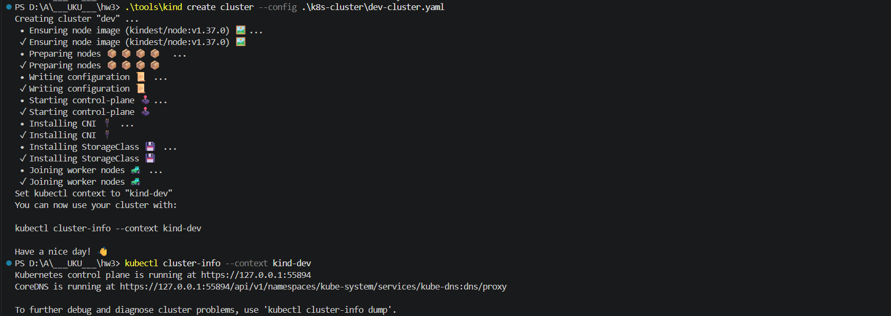

## 2. Check clusters, nodes:

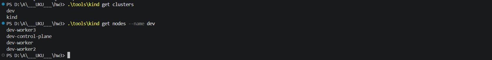

## 3. Set the current context:

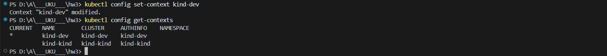

# HowTo run the project in the kind cluster

## 1. Build an image for backend service:
```bash
docker build -t backend ./nginx-golang-mysql/backend
```

## 2. Load the image into the cluster:

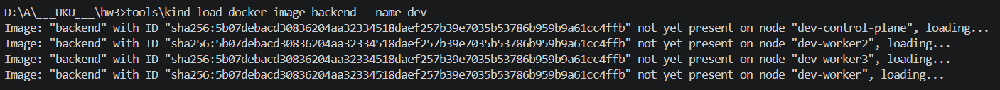

## 3. Deploy configuration to the cluster:

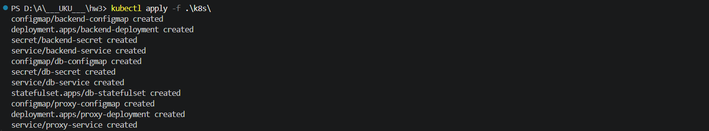

## 4. Check pods, services, delpoyments, statefulsets:

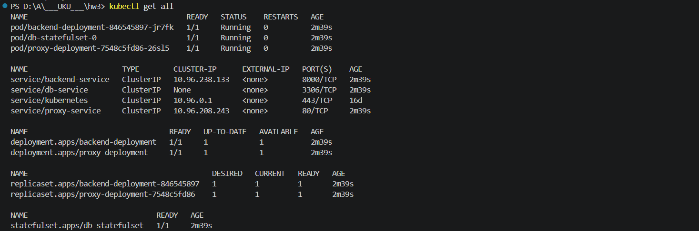


## 5. Check configmaps:

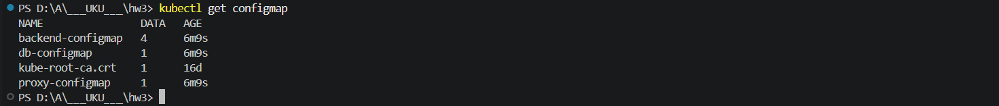

## 6. Check secrets:

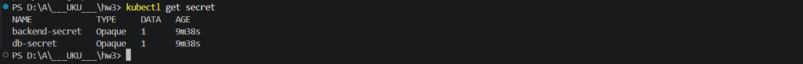

## 7. Check persistent volume claims:

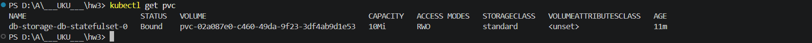

## 8. Check persistent volumes:

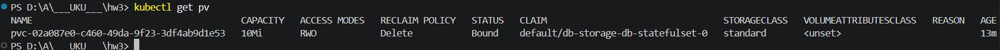

## 9. Call the application in the browser:

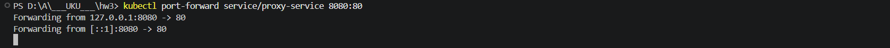

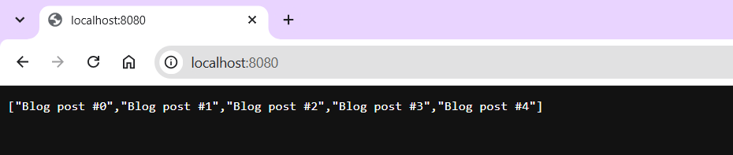

# HowTo Cleanup

## 1. Delete pods, services, delpoyments, statefulsets, configmaps, secrets:

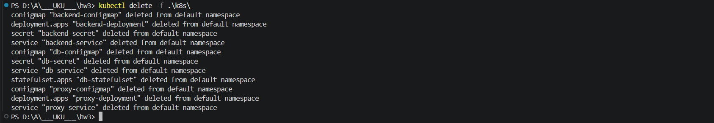

## 2. Delete persistent volume claims, persistent volumes:

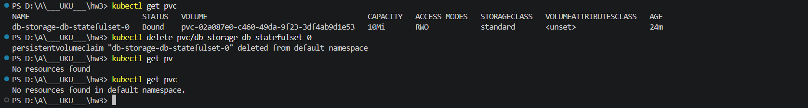

## 3. Delete kind cluster dev:

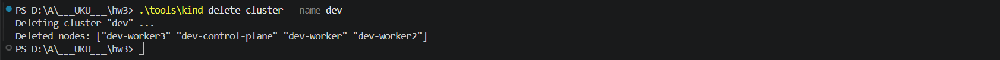